<!-- KIT-VERSION: 1.17.0 -->
# Comprendre la méthode Besoin2Plan — le guide expliqué

> `ESSENTIEL.md` donne la philosophie en une page, `METHODE-Besoin2Plan.md` la référence complète.
> Ce guide se place entre les deux : il **explique** comment le chantier s'organise, comment les
> relectures adversariales fonctionnent, d'où viennent les tests, ce qu'est une gate et comment on
> la passe, et comment la méthode encaisse les changements. Chaque notion est illustrée par un
> chantier réel : **APP-36 TheBeneficiaire** (kit 1.16.0, gates P-0 à P-3 passées en novembre 2026).

---

## 1. L'idée en trois phrases

1. On part d'un **besoin** (trois phrases, ou un cahier des charges) et on arrive à un **plan
   technique exécutable**, puis au code, phase par phase.
2. Chaque chose écrite doit être **prouvée par quelque chose d'extérieur à elle** : une user story
   par son test, une règle par son contre-exemple, une spec par un relecteur qui ne l'a pas écrite,
   une phase par une démonstration.
3. Le commanditaire décide aux **six arrêts** ; l'agent pilote fait tout le reste entre deux arrêts.

---

## 2. L'organisation du chantier

### 2.1 Les rôles (le « casting », déclaré en M0)

| Rôle | Ce qu'il fait | Chez APP-36 |
|---|---|---|
| **Commanditaire** | exprime le besoin, tranche les arbitrages, donne le go, recette les gates | Jean-Marc |
| **Pilote** | l'agent (Claude Code) : écrit les livrables, lance générateur et contrôles, tient le journal | Claude, via `/besoin2plan` |
| **Relecteur hors-famille** | un modèle d'une autre famille, qui cherche les défauts | OpenCode / MiniMax-M3, service du Hub |
| **Recetteur** | joue la démo de gate dans le rôle de l'utilisateur | le commanditaire |

Une même personne peut cumuler plusieurs rôles, sauf un : le pilote ne se relit jamais lui-même.

### 2.2 Les huit maillons et les six arrêts

```mermaid
flowchart LR
  M0["M0 Vision"] -->|① confirmée| M1["M1 Spec + RG + habilitations"]
  M1 -->|② signée| M2["M2 User stories"] --> M3["M3 Features & épics"]
  M3 --> M4["M4 Arbitrages"]
  M4 -->|③ un par un| M5["M5 Phasage gaté"]
  M5 -->|④ validé| M6["M6 Plan technique + matrice + plan de test"]
  M6 -->|⑤ validé| CAG["Contrôle avant go"]
  CAG -->|⑥ GO| M7["M7 Câblage puis code P-0, P-1…"]
```



| Arrêt | Le commanditaire voit | Il décide |
|---|---|---|
| ① | la vision reformulée, le casting, le profil | « oui, c'est ça » |
| ② | la spec, les fiches RG, la matrice d'habilitations | il signe |
| ③ | chaque question ouverte, avec options et recommandation | il tranche, une à la fois |
| ④ | les phases, chacune avec sa démo de fin | il valide le découpage |
| ⑤ | le plan technique et la matrice de couverture | il valide |
| ⑥ | la grille du **contrôle avant go** remplie, avec son verdict | GO, GO sous réserve, ou NO-GO |

Le profil **express** garde trois arrêts (①, ③, ⑥) ; **solo** et **client** gardent les six.
Avant ⑥, aucune ligne de code n'existe : c'est la règle la plus ferme du kit.

### 2.3 Où vit chaque chose

```
<app>/docs/chantier/
├── _kit/                 le kit copié, figé pour toute la durée du chantier
├── PILOTAGE.md           le tableau de bord : maillon courant, fait / reste, décisions attendues
├── KIT-FRICTIONS.md      ce qui a gêné dans le kit (nourrit la version suivante)
├── us-data.yml           LA source des US, features, épics, RG et rôles
├── M0-vision/ … M7-execution/      un dossier par maillon
├── tests-squelettes/     les scénarios Gherkin générés depuis us-data.yml
└── tracking/
    ├── relectures/       les sorties brutes des relecteurs (preuves)
    ├── controle-avant-go-<date>.txt
    └── P-0/ P-1/ …       par phase : STATE, JOURNAL, DECISIONS, BLOCKERS, PLAN-TESTS, captures
```

Une nouvelle session reprend le chantier en lisant `PILOTAGE.md` : rien ne vit dans la mémoire de
l'agent.

---

## 3. La confrontation adversariale

### 3.1 Pourquoi un relecteur d'une autre famille

Un modèle qui relit son propre texte, ou une autre session du même modèle, partage ses angles
morts : il trouve cohérent ce qu'il a lui-même construit. La méthode demande donc un relecteur
**différent en nature** — un humain du métier, ou un modèle d'une autre famille. Par défaut, c'est
le service de relecture **OpenCode (MiniMax-M3)** du Hub `.net`, appelé par MCP.

### 3.2 Quand, et avec quelle posture

| Maillon | Agent de relecture | Ce qu'il cherche |
|---|---|---|
| **M1** spec | `relecteur-spec` | termes flous, règle sans contre-exemple, droit d'accès non qualifié, exigence intestable, invention par rapport au besoin |
| **M4** arbitrages | `relecteur-spec` | décision sans « pourquoi », option oubliée, décision qui contredit la spec |
| **M6** plan | `relecteur-adversarial` | US sans brique, brique sans référence, service du Hub réécrit, faille d'identité ou de secret, test manquant |

En M6, la posture est franchement **adversariale** : le relecteur a pour consigne de faire tomber
le plan, pas de l'approuver.

### 3.3 Le déroulé d'une relecture

1. Le pilote envoie les pièces (sans aucun secret : elles partent chez un fournisseur externe).
2. Le relecteur rend une liste de défauts classés par gravité — **P0** bloquant, **P1** important,
   **P2** amélioration.
3. La sortie **brute** est archivée dans `tracking/relectures/` : c'est la preuve que la relecture a
   eu lieu, et ce qu'elle a dit.
4. Le pilote **contre-vérifie chaque défaut** : le relecteur peut se tromper lui aussi. Chaque
   défaut est soit corrigé, soit écarté avec sa raison, soit transformé en arbitrage M4.
5. Pour les livrables lourds, une **contre-relecture** fait vérifier par le même relecteur que les
   corrections tiennent.

**Chez APP-36** : la relecture M1 a relevé 13 défauts P0 et 15 P1 ; la contre-relecture
(`contre-relecture-opencode-M1.md`) a vérifié les corrections une à une. Le plan M6, volumineux, a
été relu en deux lots (`relecture-opencode-M6-A.md`, `-B.md`).

Si aucun relecteur ne répond, le pilote le dit et demande lequel employer. Une relecture faite par
le pilote lui-même ne se présente jamais comme externe.

### 3.4 Le contrôle avant go : la dernière confrontation

Juste avant l'arrêt ⑥, la conception est confrontée au **contrat d'architecture** de la plateforme :
neuf sections (données, identité, exposition, secrets, ce qui ne se réécrit pas, architecture,
exploitation, traçabilité, qualité). La moitié des lignes est vérifiée par un script
(`controle-avant-go.sh`, points 🤖) ; le reste à la main. Un écart se lève de deux façons
seulement : **on corrige la conception**, ou **on en fait une décision M4 datée**. Les sections
identité, exposition et secrets ne se négocient pas.

---

## 4. Les tests : d'où ils viennent, ce qu'ils prouvent

### 4.1 Les tests naissent en M1, bien avant le code

Le contenu des tests s'écrit pendant la spécification :

- chaque **user story** porte ses **critères d'acceptation** (CA-1, CA-2…) ;
- chaque **règle de gestion** (RG) porte un **exemple conforme** et un **contre-exemple rejeté** ;
- chaque case ⛔ de la **matrice d'habilitations** (« ce rôle n'a pas le droit ») appelle un test
  qui vérifie le refus.

Au moment de coder, on sait donc déjà ce qui doit être vrai.

### 4.2 La génération : du YAML aux scénarios Gherkin

Tout part de `us-data.yml`. Le générateur `gen-fiches-us.py` en tire, de façon déterministe :
les fiches US, features et épics, les fiches RG, la matrice d'habilitations, et les
**squelettes de test** en Gherkin dans `tests-squelettes/`.

**Gherkin** est un format de scénario lisible par le métier (`Étant donné… Quand… Alors…`). Un
squelette généré chez APP-36 :

```gherkin
@US-A1 @feat-F-A1 @epic-A
Fonctionnalité: A1 · Ouvrir mon dossier seul
  Scénario: A1 CA-3
    # Alors Un courriel qui a déjà un dossier ne crée pas un second dossier.
```

Le squelette est un **cahier des charges du test** : le développeur l'implémente en vrai test dans
le dépôt de code. Les fiches générées ne s'éditent jamais à la main — on modifie le YAML et on
régénère.

### 4.3 Les étiquettes rendent la couverture calculable

Chaque test porte des étiquettes (« tags ») qui le rattachent à ce qu'il prouve :

| Étiquette | Sens |
|---|---|
| `@US-A1` | prouve la user story A1 |
| `@RG-07` | prouve la règle RG-07 (conforme ou rejet) |
| `@neg` | test négatif : vérifie un refus d'accès |
| `@pivot` | US pivot : elle mérite aussi un test au navigateur |
| `P-1` | appartient à la phase P-1 |

Grâce à elles, la colonne **Tests** de la matrice de couverture se vérifie mécaniquement : aucune
US sans test.

### 4.4 Les trois niveaux de test

| Niveau | Ce qu'il exerce | Outil | Prouve |
|---|---|---|---|
| **Unitaire** | une classe, une fonction | JUnit 5 | la logique d'une brique |
| **Acceptation (API)** | l'application entière, démarrée, interrogée par HTTP | JUnit 5 + Testcontainers | une US ou une RG côté services |
| **E2E** | l'application vue par une personne, dans un vrai navigateur | Playwright | une US d'écran, dans le rôle |

**JUnit 5** est le cadre de test standard de Java. Une classe de test y porte ses étiquettes avec
`@Tag`, et Maven peut lancer un sous-ensemble par étiquette. Chez APP-36 :

```java
@Tag("P-1")
@Tag("US-B1") @Tag("US-B2") @Tag("US-B8") @Tag("US-B9")
@Tag("RG-01") @Tag("RG-06") @Tag("RG-07") @Tag("RG-26")
class P1ProfilEtRubriquesTest extends BancApplication {
    @Test
    @DisplayName("B1 CA-1, CA-2 / RG-07 : … complet avec la seule tranche d'âge, jamais de date de naissance")
    …
```

**Testcontainers** démarre de vraies dépendances dans des conteneurs Docker le temps du test :
PostgreSQL, MinIO (S3), ClamAV. C'est ce qu'on appelle **le banc** : l'application entière, sur un
port réel, contre de vraies dépendances. L'identité arrive par les en-têtes `X-SSO-*`, posés comme
le Hub les pose après authentification — c'est l'entrée contractuelle de l'app. Sans Docker, ces
tests sont **désactivés** (état `en_attente`), jamais verts par défaut.

### 4.5 E2E, c'est quoi ?

**E2E = *end-to-end*, « de bout en bout ».** Un test E2E joue un parcours comme le ferait une
vraie personne : il ouvre un navigateur, se connecte dans le rôle (bénéficiaire, consultant,
visiteur), clique, saisit, lit l'écran, et vérifie ce qui s'affiche. Il traverse toute la chaîne —
interface, API, base, stockage, et en recette le proxy et le SSO du Hub.

Chez APP-36, l'outil est **Playwright** (TypeScript), dans `thebeneficiaire/e2e/`, avec deux
fichiers par phase :

- `p1-local.spec.ts` — contre le **banc local** (vraies dépendances en conteneurs) ;
- `p1-recette.spec.ts` — contre l'**application déployée en recette** (`thebeneficiaire.thesocle.net`,
  derrière le Hub `.net`), avec le vrai courriel et le vrai SSO.

**Pourquoi il en faut, même avec 200 tests d'API verts** : un test d'API ne voit ni un bouton qui
ne fait rien, ni un texte figé qui contredit l'état réel, ni une page sans issue, ni un panneau
dont le bas est inatteignable faute d'ascenseur. Le RETEX Your360 (2026-10-26) a trouvé cinq
défauts de ce genre en une soirée, tous invisibles à 202 tests de services verts. D'où la règle :
**une US d'écran a deux preuves** — son test d'API et son scénario E2E dans le rôle.

L'E2E travaille dans une **fenêtre réelle de 1280 × 900** (ou un téléphone, iPhone 13 chez APP-36
pour le visiteur), descend à la molette jusqu'au dernier élément, et prend ses captures **à la
taille de la fenêtre**, jamais en « pleine page » : une capture pleine page montre aussi ce que
personne ne peut atteindre.

### 4.6 Zéro mock

Aucun test ne remplace une dépendance par une imitation. Si une dépendance réelle manque, le test
est en attente et l'application affiche un état honnête (`en_attente`, `identite_indisponible`),
jamais un faux succès. Un test vert prouve donc que le vrai système marche.

---

## 5. Les gates : comment une phase se ferme

### 5.1 Une gate est une démonstration

Chaque phase P-x se termine par une **gate**, formulée en M5 comme une démonstration vue par le
rôle. Celle de P-3 chez APP-36 :

> « Le **bénéficiaire** publie son CV par lien, le **visiteur** le lit sur son téléphone, le
> bénéficiaire renouvelle l'adresse et l'ancienne ne répond plus ; il voit le nombre de lectures,
> fige une version datée, produit sa lettre et sa synthèse de compétences. »

Une gate se valide en **montrant**, jamais en cochant une liste de tâches.

### 5.2 Le passage d'une gate, pas à pas

1. **Plan de test de la phase** (`tracking/P-x/PLAN-TESTS.md`, rédigé depuis `TEMPLATE-TESTS.md`) :
   chaque US et RG de la phase avec ses tests, leur niveau (API, E2E, démo manuelle), leur état.
2. **Banc** : les tests d'acceptation JUnit de la phase passent, avec les négatifs `@neg`.
3. **E2E local** : les scénarios Playwright de la phase passent, captures archivées.
4. **Non-régression** : les tests **de toutes les phases précédentes** repassent. Une phase qui
   casse une phase fermée ne se ferme pas.
5. **Recette** : l'application est livrée sur `.net` et l'E2E de recette rejoue le parcours à
   travers le vrai Hub, plus la non-régression des phases précédentes en recette.
6. **Liste fixe de la gate d'écran**, vérifiée pour chaque écran :
   - dans le rôle, connecté comme la personne ;
   - dans une fenêtre réelle, jusqu'au dernier élément ;
   - chaque état de l'objet montre un bouton, ou dit pourquoi il n'y en a pas ;
   - chaque fin d'étape a une sortie ;
   - le texte dit l'état réel.
7. **Démo au recetteur** du non-automatisable, puis inscription dans `tracking/P-x/STATE.md` : date,
   version livrée, commit, nombre de tests passés, captures.

**La trace réelle de P-3 chez APP-36** (`tracking/P-3/STATE.md`) : banc `P3PagesWebTest` 7/7 et
`P3AutresDocumentsTest` 5/5 ; E2E `p3-local` 3/3 (visiteur sur iPhone 13) ; recette `p3-recette`
1/1 à travers le proxy du Hub ; non-régression `p2-recette` 2/2 ; version 1.4.0, commit `4c954cb`.
Gate passée le 2026-11-08.

### 5.3 Quand la gate échoue

La phase reste ouverte. L'échec s'écrit dans `BLOCKERS.md`, puis une décision dans `DECISIONS.md` :
**redémo** après correction, **descope** (des US passent à une phase suivante, la matrice est mise
à jour), ou **retour à un maillon** (M4 si une décision est en cause, M6 si c'est le découpage).
Deux gates ajournées de suite sur la même phase : le pilote **propose** d'arrêter le chantier, le
commanditaire décide.

---

## 6. Les changements : comment la méthode les encaisse

### 6.1 Pendant un chantier : le papier suit le réel

Quand le code révèle qu'un livrable amont est faux, on corrige le livrable, et la correction reste
visible :

- la spec M1 gagne une ligne dans sa section **« Révisions »** (date, quoi, pourquoi) ;
- la ligne de la matrice de couverture change, avec sa colonne **« Statut / révisé le »** ;
- une US ne se supprime jamais : elle est **splittée** (A1 → A1.1, A1.2) ou **abandonnée**, barrée,
  avec sa raison en M4.

La matrice de couverture reste ainsi juste **à tout moment**, pas seulement le jour du plan.

### 6.2 Le kit est figé pendant un chantier

Le `_kit/` copié dans l'instance ne se modifie pas, même pour corriger une erreur évidente. Toute
gêne s'écrit à chaud dans `KIT-FRICTIONS.md`, une ligne par friction. Le chantier garde ainsi des
règles stables du début à la fin.

### 6.3 Le kit évolue entre les chantiers

- **Une version du kit = un retour d'expérience de chantier réel** (`TEMPLATE-RETEX.md`, nourri par
  `KIT-FRICTIONS.md` et les mesures de `PILOTAGE.md`).
- Chaque changement est décrit dans [`CHANGELOG.md`](CHANGELOG.md) ; chaque fichier porte sa
  `KIT-VERSION`, et `conception/KIT-VERSION.txt` donne celle du kit entier.
- Une règle issue d'un seul chantier est marquée **⚗️ candidate** jusqu'à sa confirmation par un
  second ; chaque template porte `PROUVE-SUR:` (les chantiers qui l'ont éprouvé).
- Une instance se met à niveau entre deux chantiers par la procédure **Resync** du `README.md` :
  comparer sa version au CHANGELOG, reporter, marquer la nouvelle version.

Exemple : la liste fixe de la gate d'écran et la règle « une US d'écran a deux preuves » sont
entrées dans le kit en 1.10.0, issues du RETEX Your360.

---

## 7. Lexique

| Terme | Sens |
|---|---|
| **US** (user story) | « En tant que <acteur>, je veux <capacité>, afin de <bénéfice> », avec ses critères d'acceptation |
| **CA** | critère d'acceptation : une condition vérifiable de l'US |
| **RG** | règle de gestion, avec son exemple conforme et son contre-exemple rejeté |
| **Feature / épic** | regroupements d'US : la feature est une capacité démontrable d'un bloc, l'épic un thème de valeur |
| **Phase P-x** | un lot de features livré ensemble, fermé par sa gate |
| **Gate** | la démonstration qui ferme une phase, rejouée avec la non-régression |
| **Non-régression** | rejouer les tests des phases déjà fermées pour vérifier qu'elles marchent encore |
| **Matrice de couverture** | le tableau US → feature → épic → phase → brique → tests → gate ; seul lieu où les trois axes se croisent |
| **Brique** | un composant technique : worker, service, stage, pack |
| **Arbitrage** | une décision tranchée en M4, avec son pourquoi |
| **Relecteur adversarial** | un relecteur d'une autre famille, chargé de trouver les défauts |
| **Contrôle avant go** | la grille qui confronte la conception au contrat d'architecture, avant l'arrêt ⑥ |
| **Gherkin** | format de scénario lisible (`Étant donné / Quand / Alors`) ; les squelettes générés sont en Gherkin |
| **JUnit 5** | le cadre de test standard de Java ; `@Tag` y rattache un test à une US, une RG, une phase |
| **Testcontainers** | bibliothèque qui démarre de vraies dépendances (PostgreSQL, MinIO, ClamAV) en conteneurs pendant les tests |
| **Banc** | l'application entière, démarrée sur un port réel, contre ces vraies dépendances |
| **E2E** (*end-to-end*) | test « de bout en bout » : un vrai navigateur joue le parcours d'une personne, à travers toute la chaîne |
| **Playwright** | l'outil qui pilote le navigateur pour les tests E2E |
| **Recette** | l'environnement `.net` où l'app livrée est vérifiée avant la production `.io` |
| **`en_attente`** | l'état honnête affiché ou rendu quand une dépendance réelle manque |

---

*Pour aller plus loin : [`ESSENTIEL.md`](ESSENTIEL.md) (la philosophie) ·
[`USAGE.md`](USAGE.md) (démarrer un chantier) ·
[`conception/METHODE-Besoin2Plan.md`](conception/METHODE-Besoin2Plan.md) (la référence) ·
[`conception/TEMPLATE-TESTS.md`](conception/TEMPLATE-TESTS.md) (le plan de test) ·
[`conception/TEMPLATE-CONTROLE-AVANT-GO.md`](conception/TEMPLATE-CONTROLE-AVANT-GO.md) (la grille).*
