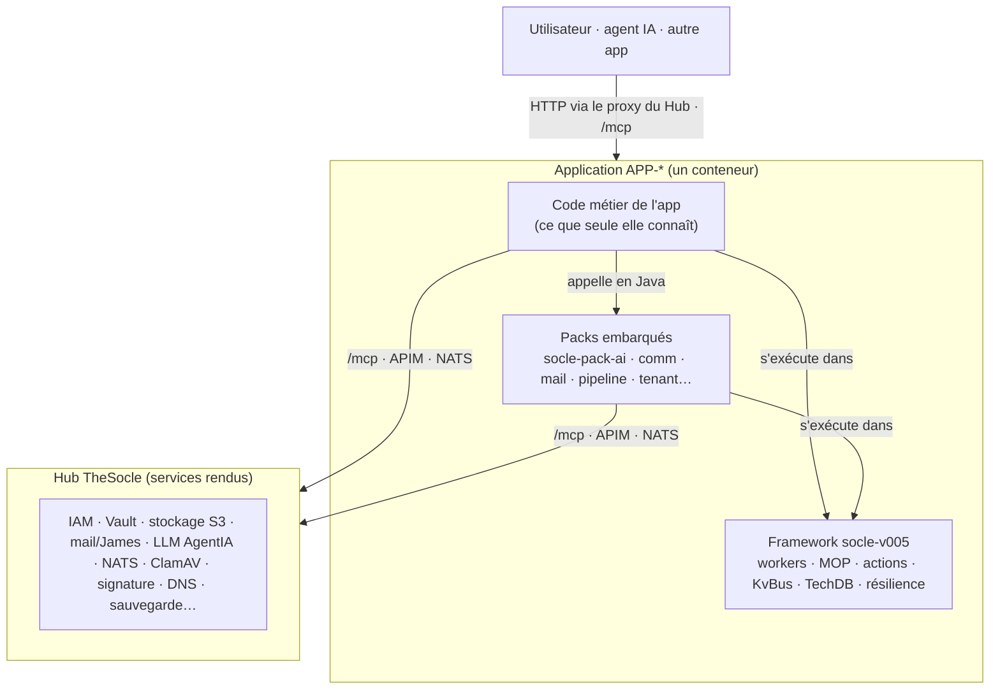
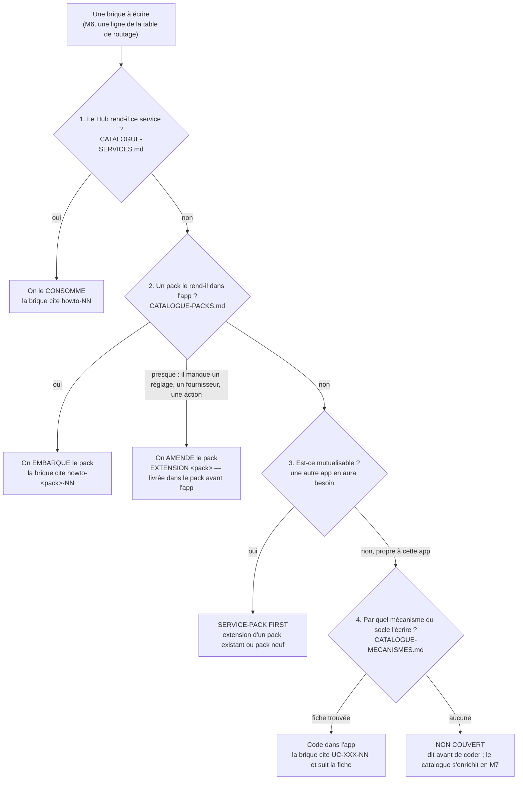

<!-- KIT-VERSION: 1.13.0 -->
# Pilier CONCEPTION — la méthode M0→M7 · RG · Habilitations · Tests

> **LE kit de conception** : la chaîne complète Besoin→Plan (M0→M7) + les artefacts que le client
> signe (RG, habilitations) + la preuve (tests). Premier des 3 piliers du kit
> (conception / [conformité](../conformite/) v1.5 / [run](../run/) v1.6), activés via le casting M0.
> Copier **ce dossier** comme `_kit/` d'un nouveau chantier (cf. [`../USAGE.md`](../USAGE.md)).

- 📘 **[`METHODE-Besoin2Plan.md`](METHODE-Besoin2Plan.md)** — la méthodologie de référence (preuve
  externe, 3 axes, piliers, boucles de retour dont §2.4 arrêt, matrice). **À lire en premier**
  (après [`../ESSENTIEL.md`](../ESSENTIEL.md)).
- 🎚️ **[`PROFILS.md`](PROFILS.md)** — seuil d'entrée, mode d'entrée (besoin exprimé / **CdC
  fourni** avec ingestion tracée), profils express / solo / client.
- 📊 **[`TEMPLATE-RETEX.md`](TEMPLATE-RETEX.md)** — le post-mortem méthode d'un chantier : ce qui
  fait évoluer le kit (1 version = 1 RETEX ; fait vivre les marqueurs `PROUVE-SUR`).
- 🛠️ **[`gen-fiches-us.py`](gen-fiches-us.py)** — générateur **générique** : fiches US/Feature/Épic/RG,
  matrice d'habilitations, squelettes de tests Gherkin. Données dans un **YAML externe** :
  `python3 gen-fiches-us.py <us-data.yml>` — modèle : [`us-data.example.yml`](us-data.example.yml).
- 🎛️ **[`PROMPT-PILOTE.md`](PROMPT-PILOTE.md)** — **LE prompt unique** qui déroule tout le chantier
  M0→M7 (l'agent avance seul, ne s'arrête qu'aux 6 décisions du commanditaire, tient `PILOTAGE.md`).
- 💬 **[`PROMPT-generer-fiches-US.md`](PROMPT-generer-fiches-US.md)** — (re)générer les fiches
  (script **ou** prompt agent IA).
- 🗂️ **Les trois catalogues du routage (M6)**, consultés dans cet ordre :
  [`CATALOGUE-SERVICES.md`](CATALOGUE-SERVICES.md) (le Hub le rend-il ?) →
  [`CATALOGUE-PACKS.md`](CATALOGUE-PACKS.md) (un pack le rend-il dans l'app ?) →
  [`CATALOGUE-MECANISMES.md`](CATALOGUE-MECANISMES.md) (par quel mécanisme écrire le reste ?).
  Les guides qu'ils citent sont livrés ici : `services-disponibles/`, `services-pack/`, `use-cases/`.

## Services, packs et mécanismes — où chercher et qui appelle qui

Une app TheSocle n'écrit que ce que **seule elle connaît**. Tout le reste existe déjà à l'un de
trois étages, chacun avec son propriétaire et sa règle :

| Étage | Ce que c'est | Ce que l'app en fait | Si ça manque |
|---|---|---|---|
| **Service du Hub** | une capacité rendue par la plateforme, hors de l'app : IAM, Vault, stockage, mail, LLM par l'APIM, NATS, antivirus, signature… | elle le **consomme** (par `/mcp`, l'APIM, NATS…), jamais elle ne le recode | on le demande au Hub (nouveau service ou évolution) |
| **Pack du socle** (`socle-pack-*`) | une bibliothèque embarquée dans l'app : IA, notifications, connecteurs SaaS, éditorial, courrier par utilisateur, pipelines DAG, tenant, sortie réseau | elle l'**embarque quand elle en a besoin**, et seulement alors | on **amende le pack** (ou on en crée un) : c'est notre périmètre |
| **Framework V005** (`socle-v005`) | le moteur : workers, MOP, actions MCP/REST, KvBus, TechDB, résilience | elle **suit ses mécanismes** (fiches `UC-XXX-NN`) | on ne le modifie pas : il a son propre responsable ; la demande lui est passée en salon |

### L'ordre des appels (à l'exécution)

Le code de l'app passe **d'abord par un pack** quand il en existe un pour son besoin : le pack
connaît déjà le bon service du Hub, ses clés, ses délais et ses pièges. Un appel direct au Hub
depuis le code métier n'est justifié que si aucun pack ne couvre le besoin (ex. `storage_worker`).

### L'ordre des recherches (à la conception, M6)

**L'ordre compte.** Interrogé à l'envers, l'agent réécrit dans l'app ce que le Hub ou un pack rend
déjà — et produit une seconde implémentation qui divergera de la première.

**Service-pack first — la règle.** Tout ce qui peut être mutualisé l'est : une capacité dont une
autre app aura besoin va dans un pack, pas dans l'app. Concrètement :

- **on embarque un pack quand on en a besoin**, pas par défaut : chaque pack ajoute des tables, des
  workers et des dépendances ;
- **un pack s'amende** : s'il lui manque un réglage, un fournisseur, une action, ou s'il a un défaut
  (colonne « État » de `CATALOGUE-PACKS.md`), on corrige ou on étend **le pack**, on ne code pas un
  contournement parallèle dans l'app. Signal d'alerte : un client HTTP, un client LLM ou une table de
  notifications écrits dans l'app alors qu'un pack les fournit ;
- l'extension est une brique de M6 à part entière : elle porte `EXTENSION <pack> — <ajout>` dans la
  colonne « Pack embarqué », elle a ses tests dans le pack, une version du pack, et **ses howtos mis
  à jour** dans `services-pack/` (consigne écrite dans le `CLAUDE.md` de chaque pack) ;
- le framework V005 n'est pas un pack : on ne l'amende pas depuis un chantier.

Où la règle s'applique dans la chaîne : **M1** (un besoin qui ressemble à un service ou à un pack
est vérifié dès la spec) · **M6** (§3 bis du gabarit : table de routage) · **arrêt ⑥** (contrôle
avant go, points 5.1, 5.6, 5.7, 5.10) · **M7** (l'extension de pack est livrée avant l'app qui la
consomme ; un `NON COUVERT` résolu enrichit un catalogue).

## Les templates

| Template | Pour |
|---|---|
| [`TEMPLATE-M0-vision.md`](TEMPLATE-M0-vision.md) | M0 · Vision + **casting** + piliers activés |
| [`TEMPLATE-M1-spec-besoins.md`](TEMPLATE-M1-spec-besoins.md) | M1 · Spec de besoins (+ NFR, révisions) |
| [`TEMPLATE-M2-user-stories.md`](TEMPLATE-M2-user-stories.md) · [`TEMPLATE-US.md`](TEMPLATE-US.md) | M2 · index + **fiche US** (axe métier seul) |
| [`TEMPLATE-M3-epics.md`](TEMPLATE-M3-epics.md) · [`TEMPLATE-EPIC.md`](TEMPLATE-EPIC.md) · [`TEMPLATE-FEATURE.md`](TEMPLATE-FEATURE.md) | M3 · index + **fiche épic** + **fiche feature** (hiérarchie **Épic → Feature → US**, obligatoire) |
| [`TEMPLATE-M4-arbitrages.md`](TEMPLATE-M4-arbitrages.md) | M4 · Arbitrages |
| [`TEMPLATE-M5-phasage.md`](TEMPLATE-M5-phasage.md) | M5 · Phasage gaté (+ convention de préfixe) |
| [`TEMPLATE-M6-plan-technique.md`](TEMPLATE-M6-plan-technique.md) | M6 · Plan + **routage des briques** (service du Hub / pack embarqué / fiche de mécanisme) + matrice (colonne Tests) + mapping IAM |
| [`TEMPLATE-M7-execution.md`](TEMPLATE-M7-execution.md) | M7 · Exécution & câblage (+ suivi par phase) |
| [`TEMPLATE-RG.md`](TEMPLATE-RG.md) | **fiche règle de gestion** (M1 — typée, tracée, testable) |
| [`TEMPLATE-HABILITATIONS.md`](TEMPLATE-HABILITATIONS.md) | **matrice rôle × US** (M1, signée métier) + mapping IAM (M6) |
| [`TEMPLATE-TESTS.md`](TEMPLATE-TESTS.md) | **plan de test par phase** (M6.5, gate scriptée) |
| [`TEMPLATE-PARCOURS-MAQUETTES.md`](TEMPLATE-PARCOURS-MAQUETTES.md) | **parcours + maquettes des US pivots** (entre M2 et M5, validés avant M6 — recommandé client) |
| [`TEMPLATE-INTERFACES-REPRISE.md`](TEMPLATE-INTERFACES-REPRISE.md) | **brownfield** : contrats d'interface (IF-x) + reprise de données legacy (phase dédiée) |

**Règle** : chaque instance remplace les `{{placeholders}}`, garde la section **Relations (mermaid)**,
et vérifie sa **DoD** avant le maillon suivant. Relecture **requise** M1/M4/M6. Versions :
`KIT-VERSION` en tête de chaque fichier + [`../CHANGELOG.md`](../CHANGELOG.md).

## Le modèle de test aligné sur les 3 axes (doctrine)

Pas de mapping naïf « US→unitaires, épic→intégration » (même piège que « 1 épic = 1 worker ») :
**US → ≥ 1 test d'acceptation** (ses CA, `@US-<code>`) · **RG → ≥ 2 tests** (conforme + rejet,
`@RG-<code>`) · **feature / épic → rollup** par tags `@feat-x` / `@epic-x` · **brique → unitaires/intégration technique** ·
**phase P-x → gate scriptée** (acceptation + non-régression des phases précédentes + démo du
non-automatisable) · **app → E2E/smoke**. Calibrage : acceptation **API par défaut**, UI/E2E réservé
aux `@pivot` ; unitaires où il y a de la vraie logique ; pas de dogme de % de couverture.

## Doctrine habilitations (frontière RBAC / RG)

Le **RBAC gros grain** vit dans l'IAM Hub (rôles/scopes du `manifest.json`, vérifiés au proxy —
contrat d'architecture §5). Les **conditions fines** (ownership, états…) sont des **RG de type
`droit_acces`**, appliquées dans le code. Pas de moteur ABAC maison (anti-extrapolation).

## Génération automatique

Le générateur consomme les sections optionnelles `rg:` et `roles:` du YAML — **leur schéma de
référence est le bloc commenté en fin de [`us-data.example.yml`](us-data.example.yml)**, à
décommenter et adapter (il y reste commenté par honnêteté : les énoncés réels des RG Régie vivent
dans sa SPEC). Sans ces sections, seules les fiches US/feature/épic sont produites. Avec, il ajoute :
`M1-spec-besoins/RG/` (1 fiche/RG + index + RG orphelines signalées) ·
`M1-spec-besoins/matrice-habilitations.generated.md` (✅ dérivés des acteurs, `?` à qualifier) ·
`tests-squelettes/` (Gherkin `@US-x` / `@RG-x`, **à déplacer dans le repo de code**).

## Contrôle avant go (arrêt ⑥)

| Fichier | Rôle |
|---|---|
| `TEMPLATE-CONTROLE-AVANT-GO.md` | La grille : 9 sections, un verdict par ligne. Tout écart non levé bloque le go. |
| `controle-avant-go.sh` | Les points mécaniques (marqués 🤖 dans la grille) : nomenclature SQL, moment du trigger, propriétaire, secrets, package, `@Scheduled`, manifeste, traçabilité. Sortie 1 s'il reste un écart. |

La référence de ce qui est imposé est `CONTRAT-ARCHITECTURE.md` : la grille l'interroge, elle ne
le réénonce pas. Quand le contrat change, c'est lui qu'on modifie — pas la grille.
