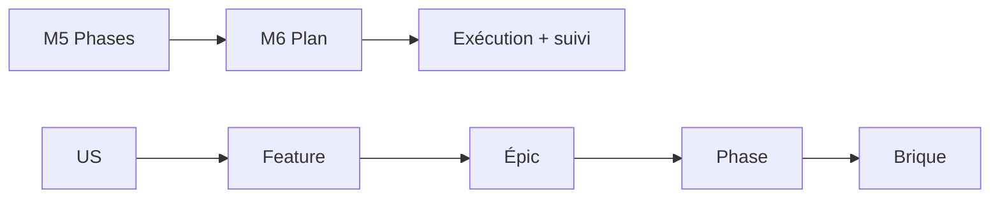

<!-- KIT-VERSION: 1.13.0 -->
<!-- PROUVE-SUR: — (niveau Feature v1.8 non prouvé ; chaîne de base prouvée sur Régie kit v1.0) -->
# M6 · Plan technique + matrice de couverture — {{nom du chantier}}

> Template. Choisir les briques **par nature** (arbre V005), **jamais par épic**. Réutiliser la
> plateforme, puis les packs (**service-pack first** : ce qui est mutualisable va dans un pack).
> La matrice est la **seule source de vérité** du mapping US→phase→brique (méthode §0).
> **Relecture requise** (méthode §1).

## 1. Rôle
Traduire chaque phase en briques techniques + prouver la couverture.

## 2. Entrée
**Phasage** (M5) + **Spec** (M1).

## 3. Livrable (par phase)
1. **Réutilisation plateforme** (ce qu'on NE code pas) · 2. **Briques nouvelles**
(worker/service/stage/package) · 3. **Modèle de données** · 4. **Matrice de couverture** ·
5. **Plan de test** (`TEMPLATE-TESTS.md` — tagging `@US-x`/`@RG-x`, gate scriptée, non-régression
des gates précédentes) · 6. **Mapping habilitations → IAM** (rôles métier → rôles/scopes
`manifest.json` + mode SSO par route, §3 de `TEMPLATE-HABILITATIONS.md`).

### 3 bis. Routage des briques (dans cet ordre : services, packs, mécanismes)
Avant d'écrire une brique, on cherche où elle est déjà décrite (schéma : `README.md` du kit) :
1. **un service de la plateforme ?** → `services-disponibles/` (table « besoin → guide » dans
   `CATALOGUE-SERVICES.md`, même dossier) : on le **consomme** et on cite le guide `howto-NN` ;
2. **sinon, un pack du socle ?** → `services-pack/` (table « besoin → howto » dans
   `CATALOGUE-PACKS.md`) : on **embarque** le pack et on cite `howto-<pack>-NN`. S'il lui manque
   presque rien ou s'il a un défaut connu (colonne « État ») : `EXTENSION <pack> — <ajout>`, livrée
   dans le pack avant l'app ;
3. **sinon, est-ce mutualisable ?** → **service-pack first** : `EXTENSION <pack>` ou
   `PACK NEUF <nom> — <capacité>`, pas du code d'app ;
4. **sinon, un mécanisme du socle ?** → `use-cases/` (table « besoin → fiche » dans
   `CATALOGUE-MECANISMES.md`) : on cite la fiche et on **suit le mécanisme qu'elle prescrit** ;
5. **sinon** → `NON COUVERT`, écrit ici avant de coder ; le catalogue s'enrichit en M7.

| Brique | Ce qu'elle fait | Service consommé (`howto-NN`) | Pack embarqué (`howto-<pack>-NN` · `EXTENSION`) | Mécanisme suivi (`UC-XXX-NN`) | Non couvert |
|--------|-----------------|-------------------------------|--------------------------------------------------|-------------------------------|-------------|
| `{{NomWorker}}` | `{{publie l'événement « idée reçue » sur NATS}}` | `{{howto-37}}` | — | `{{UC-RES-01}}` | |
| `{{NomService}}` | `{{répond aux questions avec citations}}` | — | `{{howto-ai-04}}` | — | |
| `{{NomExtension}}` | `{{ajoute le fournisseur X au pack}}` | — | `{{EXTENSION ai — fournisseur X (howto-ai-03 mis à jour)}}` | — | |
| `{{NomService2}}` | `{{calcule le score}}` | — | — | `{{UC-DOM-02}}` | |
| `{{NomStage}}` | `{{…}}` | — | — | — | `{{NON COUVERT — pourquoi, et quel catalogue enrichir}}` |

> Une brique peut citer plusieurs colonnes : elle consomme un service par un pack, ou suit un
> mécanisme du socle pour écrire un handler de pack. Une ligne sans aucune colonne remplie bloque
> le contrôle avant go. Une `EXTENSION` ou un `PACK NEUF` est une brique à part entière : phase,
> tests et version du pack, howtos de `services-pack/` mis à jour.

## 4. Relations (mermaid)

## 5. Matrice de couverture (le garde-fou)
| US | Feature | Épic | Phase | Brique technique | Tests | Gate | Statut / révisé le |
|----|---------|------|-------|------------------|-------|------|--------------------|
| `{{X1}}` | `{{F-X1}}` | `{{A}}` | `{{P-0}}` | `{{service/stage/worker}}` | `{{@US-X1 (+@RG-x, +@neg)}}` | `{{démo}}` | `{{à faire}}` |

## 6. Definition of Done
- [ ] Chaque US tracée jusqu'à une brique (aucune orpheline)
- [ ] Aucune brique sans US
- [ ] Réutilisation plateforme explicitée · **zéro mock**
- [ ] Table de routage remplie : chaque brique cite son guide, sa fiche, ou porte `NON COUVERT`
- [ ] Colonne **Tests** remplie (aucune US sans test ni démo listée) · plan de test posé
- [ ] Mapping habilitations → IAM complet (si pilier conception actif)
- [ ] **Relecture faite** (relecteur défini en M0)
