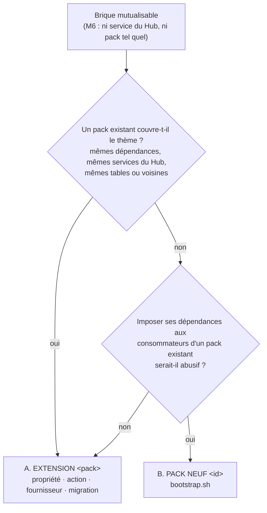

# HOWTO 00 — Créer ou amender un pack du socle (`EXTENSION <pack>` · `PACK NEUF <id>`)

**Niveau :** Avancé
**Cible :** parent `eu.lmvi:socle-v005-parent` 5.11.0 (`socle-v005` 5.11.0, minimum 5.10.0) · Spring Boot 4.1.2 · Java 21 · modèle `socle-pack-ZZ-TEMPLATE` 1.1.0
**Vérifié au code :** 2026-10-28 (pack d'essai généré par le modèle 1.1.0 : `mvn clean verify`, 16 tests verts, règle enforcer du parent passée)
**Prérequis :** la brique a été routée au plan technique (M6, §3 bis) vers `EXTENSION <pack>` ou `PACK NEUF <id>` ; Docker local (tests PostgreSQL)
**Temps estimé :** extension simple 1–2 h · pack neuf jusqu'à la 1re version : ½ à 2 jours

> Index des packs : [[00-index|services-pack]] · Table besoin → howto : [`CATALOGUE-PACKS.md`](../CATALOGUE-PACKS.md)
> Modèle : `/opt/2026-TheHub4TheSocle/socle-pack-ZZ-TEMPLATE/` (dépôt privé `jmlmvi/socle-pack-ZZ-TEMPLATE`, tag `v1.1.0`)

---

## 1. Contexte

La règle **service-pack first** ([README du kit](../README.md#services-packs-et-mécanismes--où-chercher-et-qui-appelle-qui))
dit qu'une capacité dont une autre app aura besoin va dans un pack, pas dans l'app. Au plan technique,
une telle brique porte dans la colonne « Pack embarqué » soit `EXTENSION <pack> — <ajout>`, soit
`PACK NEUF <id> — <capacité>`. Ce howto est la recette des deux.

Pourquoi une recette : les huit packs ont été montés à la main et les mêmes défauts sont revenus —
beans homonymes entre packs (`PackMigrationRunner`, `TenantResolver`) qui empêchent une app d'en
embarquer deux, collision avec le framework (`pipelineProperties`), manifestes `socle-pack.json` en
retard sur le pom, pack bâti sur un autre Spring Boot que son socle, registres de migrations partagés
entre apps, tests qui ne démarrent jamais Spring. Ces défauts n'apparaissent **que dans l'app qui
réunit les pièces** : les tests du pack seul passent. Les conventions de la partie C et les tests du
modèle les attrapent dans le pack.

**Choisir entre A et B :**



Dans le doute, **A** : un pack de plus, c'est un dépôt, une version, un manifeste, des howtos et une
ligne de compatibilité de plus à tenir pour toutes les apps.

---

## 2. Architecture — où vit quoi

```
/opt/2026-TheHub4TheSocle/
├── socle-pack-<id>/                      dépôt git du pack (jmlmvi/socle-pack-<id>, privé)
│   ├── pom.xml                           parent socle-v005-parent du socle visé (Boot inclus) ; socle en provided
│   ├── src/main/java/eu/lmvi/socle/pack/<id>/
│   │   ├── config/<Id>PackConfiguration  noms de beans (préfixe <id>Pack)
│   │   ├── config/<Id>Properties         socle.<id>.*
│   │   ├── migration/<Id>MigrationRunner db/<id>/V*.sql → schéma de l'app
│   │   └── <Id>Worker                    <id>_worker, actions MCP
│   ├── src/main/resources/META-INF/socle-pack.json
│   └── src/main/resources/db/<id>/V001__init.sql …
├── docs/methode-lmvi/conception/services-pack/pack-<id>/   howtos du pack (dépôt du kit)
└── APP-XX-…/<app>/mvn-repo/eu/lmvi/socle-pack-<id>/<v>/   jar + pom vendorisés par l'app
```

Le pack est livré **avant** l'app qui le consomme (M7) : l'app ne compile qu'avec la version
vendorisée.

---

## 3. A — Amender un pack existant (`EXTENSION <pack>`)

### A.1 Lire avant d'écrire

```bash
P=/opt/2026-TheHub4TheSocle/socle-pack-connectors   # le dossier réel du pack (casse : socle-pack-Connectors)
cd "$P" && git status && git log --oneline -5
cat CLAUDE.md                                       # règles du pack
cat src/main/resources/META-INF/socle-pack.json     # ce que le pack annonce
grep -n '<version>\|socle.version' pom.xml | head
```

Lire aussi `services-pack/pack-<pack>/README.md` (écarts connus) et le howto de la fonctionnalité
touchée. ⚠️ D'autres sessions travaillent sur les packs : `git status` propre et `git pull` avant de
commencer, une branche par extension (`feat/<ajout>`).

### A.2 Une propriété

La propriété va dans la classe `*Properties` du pack, sous **son** préfixe (`socle.<pack>.*`), avec un
défaut qui garde le comportement actuel — une app qui monte de version sans rien configurer ne doit
rien voir changer.

```java
// socle-pack-<pack>/src/main/java/eu/lmvi/socle/pack/<pack>/config/<Pack>Properties.java
/** Délai maximal d'un appel au fournisseur, en secondes. Défaut : 30 (comportement antérieur). */
private int timeoutSeconds = 30;

public int getTimeoutSeconds() { return timeoutSeconds; }
public void setTimeoutSeconds(int timeoutSeconds) { this.timeoutSeconds = timeoutSeconds; }
```

Puis, dans le même commit : la variable `SOCLE_<PACK>_TIMEOUT_SECONDS` dans `environment.optional`
du manifeste, la ligne du tableau des propriétés du README, et le bloc YAML de
`howto-<pack>-01-integrer-le-pack.md`.

### A.3 Une action

L'action s'ajoute au worker existant qui porte le domaine (pas de worker pour une seule action) :
déclaration dans `getActions()`, branche dans `executeAction()`, aucune valeur `null` dans le
résultat.

```java
// dans getActions()
ActionMetadata.builder()
        .name("archive_entry")
        .description("Archive une entrée (x_active = false) sans la supprimer")
        .parameters(List.of(ParameterMetadata.builder().name("key").type(ParameterType.STRING)
                .required(true).maxLength(150).description("Clé de l'entrée").build()))
        .mode(ExecutionMode.SYNC)
        .readOnly(false)
        .group("<pack>")
        .build(),

// dans executeAction()
case "archive_entry" -> {
    String key = params.getString("key", "").trim();
    if (key.isEmpty()) yield ActionResult.ofFailure("paramètre « key » obligatoire");
    int n = repository.archive(tenant(ctx), key);
    yield ActionResult.ofSuccess(Map.of("key", key, "archived", n > 0));
}
```

Le tenant vient de `ctx.tenantId()` (socle ≥ 5.10.0) et se passe en paramètre au repository.
L'action apparaît à l'app sous l'outil MCP `<worker>__archive_entry` : l'ajouter au tableau `actions`
du worker dans `socle-pack.json`.

### A.4 Une migration

Jamais de modification d'un script publié : le runner compare un checksum (dans le modèle, il refuse
de démarrer ; dans les anciens packs, il saute le script en silence — pire). On ajoute le suivant :

```sql
-- socle-pack-<pack>/src/main/resources/db/<pack>/V002__entry_archived_at.sql
ALTER TABLE ${<pack>_schema}.tr_<pack>_entry
    ADD COLUMN IF NOT EXISTS archived_at TIMESTAMPTZ;

CREATE INDEX IF NOT EXISTS idx_tr_<pack>_entry_actives
    ON ${<pack>_schema}.tr_<pack>_entry (x_partition) WHERE x_active;
```

Idempotent (`IF NOT EXISTS`), placeholder du pack, rien dans `public`, pas de `CREATE SCHEMA`. Une
nouvelle table suit la convention de la partie C et apparaît dans `tables` du manifeste.

### A.5 Version

| Changement | Version du pack |
|---|---|
| correctif sans effet visible pour l'app | correctif (`x.y.Z`) |
| propriété, action, fournisseur, migration additive | mineure (`x.Y.0`) |
| propriété renommée, action retirée, comportement par défaut changé, migration destructive | majeure (`X.0.0`) |
| changement de socle ou de Spring Boot | au moins mineure ; majeure si Boot change de ligne (4.0 → 4.1 compris) |

Le pom, `socle-pack.json` (`version`), le `CHANGELOG.md` du pack et le `README.md` du dossier
`services-pack/pack-<pack>/` portent la même version. Quand une lignée est abandonnée, le manifeste
garde la dernière version compatible (`lastBoot40Version`, `lastBoot3Version` — modèle :
`socle-pack-Connectors` 3.1.0).

### A.6 Tests

Une extension est testée **dans le pack** : unitaire pour la logique, et passage par le contexte
Spring et un vrai PostgreSQL pour tout ce qui touche la base ou le câblage. Si le pack n'a pas encore
de test de démarrage, l'extension l'ajoute en recopiant `DemarrageContexteSpringTest` et
`NomsDeBeansPrefixesTest` du modèle (§ C.3) — c'est la seule façon de voir une collision de beans.

```bash
cd /opt/2026-TheHub4TheSocle/socle-pack-<pack>
mvn -q clean verify          # vert, et aucun test « skipped » sur les classes Testcontainers
```

### A.7 Howtos et catalogue

Consigne du `CLAUDE.md` de chaque pack (« Documentation de service — à tenir à jour avec le code »),
dans le même travail :

1. howto(s) concerné(s) dans `services-pack/pack-<pack>/` : code d'exemple, étapes, « Pièges courants » ;
2. version + commit dans `services-pack/pack-<pack>/README.md` ;
3. nouvelle fonctionnalité d'envergure → nouveau `howto-<pack>-NN-*.md` + sa ligne dans `00-index.md` ;
4. défaut corrigé → retiré des pièges et de la colonne « État » de `CATALOGUE-PACKS.md`, en citant la
   version qui corrige ; ligne au `CHANGELOG.md` du kit.

### A.8 Adoption par l'app

```bash
cd /opt/2026-TheHub4TheSocle/socle-pack-<pack> && mvn -q clean install
APP=/opt/2026-TheHub4TheSocle/APP-XX-MonApp/monapp
V=<nouvelle version>
DEST=$APP/mvn-repo/eu/lmvi/socle-pack-<pack>/$V
mkdir -p "$DEST"
cp target/socle-pack-<pack>-$V.jar "$DEST/"
cp pom.xml "$DEST/socle-pack-<pack>-$V.pom"
```

Monter la version dans le pom de l'app, **commiter le `mvn-repo/`**, puis cocher dans le plan (M7)
que l'extension est livrée avant la brique qui la consomme. ⚠️ Une app reste parfois épinglée sur
une ancienne version de pack : vérifier que la montée ne lui fait pas changer de socle ou de Boot.

---

## 4. B — Créer un pack (`PACK NEUF <id>`)

### B.1 Générer

```bash
cd /opt/2026-TheHub4TheSocle
socle-pack-ZZ-TEMPLATE/bootstrap.sh facture \
    --description "Factures : numérotation légale, PDF, archivage."
```

Le script crée `socle-pack-facture/` (dépôt git `main`, premier commit) et amorce
`docs/methode-lmvi/conception/services-pack/pack-facture/` (`README.md` + `howto-facture-01-integrer-le-pack.md`).
`--sans-doc` saute l'amorce, `--classe NotifSms` règle le CamelCase d'un id composé. L'id suit
`[a-z][a-z0-9]{1,29}` — sans tiret : il devient paquet Java, préfixe de beans et nom SQL. Le script
refuse un id déjà pris, à la casse près (`mail` → `socle-pack-Mail` existe : c'est une extension).

### B.2 Vérifier que le squelette tourne, avant d'y toucher

```bash
cd /opt/2026-TheHub4TheSocle/socle-pack-facture
mvn -q clean verify
grep -h 'testsuite ' target/surefire-reports/*.xml | grep -oP 'name="[^"]+"|tests="\d+"|skipped="\d+"'
```

Attendu : 4 classes, 16 tests, 0 sauté. Ce que le squelette apporte déjà :

| Fichier | Ce qu'il tient |
|---|---|
| `config/FacturePackConfiguration` | `PREFIXE_BEAN = "facturePack"` et les constantes de nom de chaque bean |
| `config/FactureProperties` | `socle.facture.enabled`, `.schema`, `.list-limit-max` ; bean `facturePackProperties` |
| `migration/FactureMigrationRunner` | `db/facture/V*.sql` dans le schéma de l'app (vérifié dans `pg_catalog`, jamais créé), registre `<schéma>.z_pack_migrations`, transaction + verrou consultatif, checksum bloquant |
| `repo/FactureRepository` | `JdbcTemplate` **privé**, tenant explicite, `CAST(? AS VARCHAR)`, upsert idempotent |
| `FactureWorker` | `facture_worker` PASSIVE : `get_status`, `put_entry`, `list_entries` |
| `db/facture/V001__init.sql` | `tr_facture_entry` à la convention TheSocle |
| `META-INF/socle-pack.json` | manifeste aux clés existantes |

### B.3 Remplacer l'exemple par le service

Dans cet ordre, en gardant `mvn -q clean verify` vert à chaque pas :

1. **Tables** — réécrire `V001__init.sql` (tant qu'aucune version n'est publiée, V001 peut encore
   changer ; après, plus jamais). Garder les deux fonctions de trigger préfixées.
2. **Repository(s)** — un par agrégat, chacun `@Component(FacturePackConfiguration.BEAN_…)`. Ajouter
   la constante de nom dans `FacturePackConfiguration` pour chaque nouveau bean.
3. **Worker(s)** — garder `get_status` ; remplacer `put_entry` / `list_entries`. Un domaine = un
   worker ; un second worker = un second fichier, un second bean nommé.
4. **Propriétés** — supprimer `list-limit-max` si inutile, ajouter les vraies.
5. **Tests** — adapter les assertions métier de `DemarrageContexteSpringTest` (aller-retour d'actions,
   tables) et de `FactureWorkerTest`. **Ne pas supprimer** le test de manifeste, le test des noms de
   beans ni `AlignementSocleTest`.
6. **Manifeste, README, CHANGELOG, CLAUDE.md** — retirer le bandeau « modèle », décrire le service.

Un nouveau bean, pour mémoire :

```java
// config/FacturePackConfiguration.java
public static final String BEAN_NUMEROTEUR = PREFIXE_BEAN + "Numeroteur";

// service/FactureNumeroteur.java
@Component(FacturePackConfiguration.BEAN_NUMEROTEUR)
public class FactureNumeroteur {
    private final FactureRepository repository;
    public FactureNumeroteur(FactureRepository repository) { this.repository = repository; }
    // …
}
```

Un pack qui a besoin d'appeler un service HTTP prend l'OkHttp **du socle** :

```xml
<properties>
    <!-- celle du socle (5.10.0 et 5.11.0) ; ne jamais en fixer une autre -->
    <okhttp.version>5.5.1</okhttp.version>
</properties>
<dependency>
    <groupId>com.squareup.okhttp3</groupId>
    <artifactId>okhttp-jvm</artifactId>
    <version>${okhttp.version}</version>
    <scope>provided</scope>
</dependency>
```

### B.4 Première version

1. Version `0.1.0` (ou `1.0.0` si l'API est stable) dans le pom ; le manifeste suit (le test le vérifie).
2. Compléter `services-pack/pack-facture/` à partir du code (retirer le bandeau « amorce »), ajouter
   la section du pack et sa ligne « Les huit packs » → « neuf » dans `00-index.md`, les lignes
   besoin → howto dans `CATALOGUE-PACKS.md`, une ligne au `CHANGELOG.md` du kit.
3. Dépôt distant privé et étiquette :
   ```bash
   cd /opt/2026-TheHub4TheSocle/socle-pack-facture
   gh repo create jmlmvi/socle-pack-facture --private --source . --push
   git tag -a v0.1.0 -m "socle-pack-facture 0.1.0 — socle 5.11.0 / Boot 4.1.2" && git push origin v0.1.0
   ```
4. `mvn -q clean install`, puis vendorisation dans la première app (§ A.8).

La checklist complète est dans le README du modèle.

---

## 5. C — Conventions communes à tous les packs

### C.1 Identité

| Élément | Règle | Exemple `facture` |
|---|---|---|
| artifactId | `socle-pack-<id>` | `socle-pack-facture` |
| paquet Java | `eu.lmvi.socle.pack.<id>` | `eu.lmvi.socle.pack.facture` |
| propriétés | `socle.<id>.*` | `socle.facture.schema` |
| variables | `SOCLE_<ID>_*` (liaison souple) | `SOCLE_FACTURE_SCHEMA` |
| beans | nom explicite préfixé `<id>Pack` | `facturePackWorker` |
| worker / outils MCP | `<id>_worker` / `<id>_worker__<action>` | `facture_worker__get_status` |
| migrations | `db/<id>/V<NNN>__<objet>.sql`, placeholder `${<id>_schema}` | `db/facture/V001__init.sql` |
| tables | `tr_` / `db_` / `z_` + `<id>_` | `tr_facture_entry` |

### C.2 Beans préfixés — pourquoi et comment

Spring nomme un bean d'après le nom simple de sa classe. Deux packs avec un `PackMigrationRunner`, ou
un pack avec un `PipelineProperties` à côté de celui du socle, et l'app hôte meurt au démarrage sur
`ConflictingBeanDefinitionException` — seulement dans l'app qui réunit les deux. Donc :

- `@Component("<id>Pack…")`, `@Configuration("<id>PackConfiguration")`, `@Bean("<id>Pack…")`,
  constantes rassemblées dans `<Id>PackConfiguration` ;
- **aucun bean d'infrastructure publié** (`JdbcTemplate`, `DataSource`, `ObjectMapper`,
  `OkHttpClient`, `RestClient`) : Spring Boot n'auto-configure le sien que s'il manque
  (`@ConditionalOnMissingBean`), et deux packs qui publient chacun le leur rendent l'injection ambiguë.
  Le pack construit ses outils en interne depuis la `DataSource` de l'app ;
- pas de nom de bean fixé par l'app : l'app injecte les beans du pack **par type**.

### C.3 Les tests qui ne se discutent pas

| Test (modèle) | Ce qu'il prouve | Sans lui |
|---|---|---|
| `DemarrageContexteSpringTest` | le pack démarre dans un contexte Boot réel (auto-config `DataSource` + `JdbcTemplate`), à côté du `WorkerActionRegistry` du socle, sur PostgreSQL Testcontainers ; migrations jouées puis non rejouées ; actions acceptées par le socle ; `JdbcTemplate` de l'app intact ; manifeste = workers, classes et actions réels | les tests instancient les classes à la main et le câblage n'est jamais prouvé |
| `NomsDeBeansPrefixesTest` | tout bean du paquet porte le préfixe ; balayer socle + pack avec le générateur de noms par défaut ne lève aucun conflit | collisions découvertes en production, app par app |
| `AlignementSocleTest` | parent Boot du pack = parent du pom du socle (lu dans le jar) = Boot du classpath ; manifeste = pom | pack Boot 4.0.6 dans une app Boot 4.1.2 : compile, casse à l'exécution |

Les classes de test qui configurent un contexte vivent **hors du paquet du pack**
(`eu.lmvi.verif.pack.<id>`) : sinon le balayage du pack ramasse leur configuration d'hôte.
`@Testcontainers` sans `disabledWithoutDocker` : un test de démarrage sauté est un test absent.

### C.4 Le manifeste `META-INF/socle-pack.json` — exact

Clés existantes, pas de clé nouvelle (`socleMin` n'existe pas) :

```json
{
  "packId": "socle-pack-facture",
  "name": "TheSocle Pack — Facture",
  "version": "0.1.0",
  "description": "Factures : numérotation légale, PDF, archivage.",
  "minSocleVersion": "5.10.0",
  "springBootVersion": "4.1.2",
  "builtAgainstSocleVersion": "5.11.0",
  "workers": [
    {
      "name": "facture_worker",
      "class": "eu.lmvi.socle.pack.facture.FactureWorker",
      "type": "PASSIVE",
      "actions": ["get_status", "put_entry", "list_entries"],
      "description": "…"
    }
  ],
  "tables": ["tr_facture_entry"],
  "patterns": [],
  "tags": ["facture"],
  "dependencies": [],
  "environment": {
    "required": [],
    "optional": [
      { "name": "SOCLE_FACTURE_ENABLED", "default": "true" },
      { "name": "SOCLE_FACTURE_SCHEMA", "default": "public" }
    ]
  }
}
```

`minSocleVersion` ≤ `builtAgainstSocleVersion` ; on ne l'abaisse qu'après avoir compilé **et** testé
le pack contre la version visée. `lastBoot40Version` / `lastBoot3Version` quand une lignée est
abandonnée. `dependencies` liste les autres packs requis (`socle-pack-editorial` →
`["socle-pack-ai", "socle-pack-comm"]`).

### C.5 Compatibilité socle / Spring Boot

- Parent Maven = **`eu.lmvi:socle-v005-parent`** à la version du socle visé (depuis 5.11.0 ; fils de
  `spring-boot-starter-parent` 4.1.2). Il fournit `${socle.version}`, importe `socle-v005-bom` (gRPC
  1.85.1, Testcontainers 1.21.4, h2/jedis/kafka/mysql/mariadb testés) et la règle enforcer
  `socle-versions-testees`. Le pom du pack ne redéclare ni `socle.version`, ni `testcontainers.version`,
  ni ces propriétés de pilotes, ni un import `grpc-bom` / `testcontainers-bom`. Pour gRPC :
  `${socle.grpc.version}`, jamais `${grpc-java.version}` (celle de Boot, 1.84.1).
- `socle-v005` en `provided`, version `${socle.version}` : l'app embarque **son** socle.
- Sans ce parent (packs antérieurs au socle 5.11) : parent Spring Boot = parent de
  `socle-v005-<v>.pom` (5.10.0 → **4.1.2** ; 5.8.6–5.9.x → 4.0.6 ; ≤ 5.8.0 → 3.2.1).
- **Piège enforcer** : ne jamais déclarer de `<configuration>` sur `maven-enforcer-plugin`. Une liste
  `bannedDependencies/excludes` redéclarée **remplace** celle du parent ; `combine.self="override"` ou
  `skip` coupent tout — les bornes disparaissent sans message (mesuré sur un pack généré). Une règle
  de plus = une autre `<execution>` avec son propre `<id>`. Contrôle : la sortie de `mvn verify`
  montre `enforce (socle-versions-testees)` puis `BannedDependencies passed`.
- Tout starter déclaré exclut `spring-boot-starter-logging` (Log4j2 partout).
- Testcontainers : 1.21.4 par le parent (Boot 4.1 en impose 2.x, le mélange casse la découverte de
  Docker ; avant le parent, il fallait importer `testcontainers-bom`), docker-java 3.5.0 et `DOCKER_API_VERSION=1.44` pour les démons Docker ≥ 29.
- OkHttp : `okhttp-jvm` 5.5.1 du socle en `provided` ; **jamais** `okhttp` 4.x en `compile` — l'app
  recevrait deux jeux de classes `okhttp3.*` et la première sur le classpath gagnerait.
- Jackson : la ligne 2 (`com.fasterxml`) vient du socle ; le pack ne fait sortir que des
  `Map`/`List`/scalaires de ses `ActionResult`.

### C.6 Base de données

Colonnes `x_id` (séquence `seq_<table>_x_id`), `x_dateCreated`, `x_dateUpdated`, `x_partition`
`VARCHAR(30)`, `x_version`, `x_active`, `x_createdBy`, `x_updatedBy`, données métier, `datas JSONB`
en dernier ; triggers `update_datechanged_<table>` et `trg_x_partition_default` sur des fonctions
**locales préfixées** `fn_<id>_*`. Unicité par tenant : `UNIQUE ((COALESCE(x_partition, '')), …)` et
le même `ON CONFLICT` — en mono-tenant `x_partition` est `NULL`. Registre des migrations dans le
schéma de l'app (`<schéma>.z_pack_migrations`), jamais dans `public`.

### C.7 Vendorisation dans l'app

Aucun pack n'est servi à jour par un dépôt distant : l'app copie jar **et** pom dans
`mvn-repo/eu/lmvi/socle-pack-<id>/<v>/` et les commite (§ A.8). Un pack présent seulement dans
`~/.m2` compile sur la box de build et casse partout ailleurs (CI, clone frais, autre session).

---

## 6. Vérification

```bash
cd /opt/2026-TheHub4TheSocle/socle-pack-<id>
mvn -q clean verify
grep -h 'testsuite ' target/surefire-reports/*.xml | grep -oP 'tests="\d+"|failures="\d+"|errors="\d+"|skipped="\d+"'
python3 -c "import json;m=json.load(open('src/main/resources/META-INF/socle-pack.json'));print(m['version'],m['minSocleVersion'],m['springBootVersion'],m['builtAgainstSocleVersion'])"
grep -m1 -A0 '<version>' pom.xml   # parent socle-v005-parent = socle visé
mvn -q validate                    # règle enforcer socle-versions-testees du parent
```

Puis, dans l'app consommatrice : `mvn -o -q package` sur un clone frais (vendorisation), démarrage
sans `ConflictingBeanDefinitionException`, et `<id>_worker__get_status` par `POST /mcp`.

---

## 7. Pièges courants

| Piège | Symptôme | Correction |
|---|---|---|
| `@Component` sans nom sur une classe au nom générique (`PackMigrationRunner`, `TenantResolver`) | l'app qui embarque deux packs ne démarre plus : `ConflictingBeanDefinitionException` | nom explicite `<id>Pack…`, `NomsDeBeansPrefixesTest` |
| classe homonyme d'une classe du socle (`PipelineProperties`) | même échec, dès qu'une app balaie `eu.lmvi.socle` | nom explicite ; le balayage socle + pack du test le voit |
| pack qui publie un `JdbcTemplate` | l'app perd son `JdbcTemplate` auto-configuré, ou injection ambiguë avec deux packs | `new JdbcTemplate(dataSource)` privé |
| parent Boot ≠ parent du socle | `NoSuchMethodError` / `ClassNotFoundException` à l'exécution dans l'app | parent `socle-v005-parent` du socle visé ; `AlignementSocleTest` |
| `<configuration>` sur `maven-enforcer-plugin` dans le pom du pack | bornes de versions du socle neutralisées, build vert | ne pas configurer ce plugin ; une autre `<execution>` si besoin |
| `okhttp` 4.x en `compile` | deux copies de `okhttp3.*` dans l'app, comportement selon l'ordre du classpath | `okhttp-jvm` 5.5.1 du socle en `provided` |
| manifeste non tenu | agents et `CapabilityRagWorker` décrivent un pack qui n'existe plus | tests de manifeste du modèle |
| clé de manifeste inventée (`socleMin`) | les outils qui lisent `minSocleVersion` ne voient rien | clés existantes (C.4) |
| migration publiée modifiée | modèle : démarrage refusé ; anciens packs : script sauté en silence, colonne absente | ajouter `V<NNN+1>__…sql` |
| registre de migrations dans `public` | la 2ᵉ app d'une base démarre sans ses tables | registre dans le schéma de l'app |
| `CREATE SCHEMA IF NOT EXISTS` dans une migration | échoue sans droit `CREATE` sur la base, même si le schéma existe | le Hub pose le schéma ; le runner vérifie dans `pg_catalog` |
| `x_partition = ?` / `? IS NULL` sans cast | rien trouvé en mono-tenant, ou requête refusée | `IS NOT DISTINCT FROM CAST(? AS VARCHAR)` |
| `ON CONFLICT (x_partition, …)` sur colonne nullable | doublons en mono-tenant | index et `ON CONFLICT` sur `(COALESCE(x_partition, ''))` |
| `isHealthy()` qui sonde un tiers | le superviseur redémarre le worker en boucle, journaux illisibles | santé du worker seul ; joignabilité du tiers dans `getStats()` ; `isEnabled()` pour « non configuré » |
| configuration de test dans le paquet du pack | le balayage du pack ramasse l'hôte de test, contexte faux | tests de contexte dans `eu.lmvi.verif.pack.<id>` |
| test de démarrage sauté sans Docker | « vert » sans avoir rien prouvé | `@Testcontainers` sans `disabledWithoutDocker` |
| pack seulement dans `~/.m2` | l'app compile sur la box, casse en CI et sur clone frais | vendoriser jar + pom dans `mvn-repo/` |
| howtos non mis à jour | le plan M6 suivant est écrit sur un pack qui n'existe pas | consigne « Documentation de service » du `CLAUDE.md` du pack |

---

## 8. Pour aller plus loin

- `/opt/2026-TheHub4TheSocle/socle-pack-ZZ-TEMPLATE/README.md` — le modèle, la checklist avant la 1re version
- [[00-index|services-pack]] — les huit packs et leurs howtos ; [`CATALOGUE-PACKS.md`](../CATALOGUE-PACKS.md)
- [`TEMPLATE-M6-plan-technique.md`](../TEMPLATE-M6-plan-technique.md) §3 bis — déclarer `EXTENSION` / `PACK NEUF`
- `docs/02-DocHub/institutional/100-socle-packs-integration.md` — les packs dans l'écosystème
- [[howto-28-integrer-un-socle-pack-dans-une-app|HOWTO 28]] — côté app, l'intégration générique d'un pack
